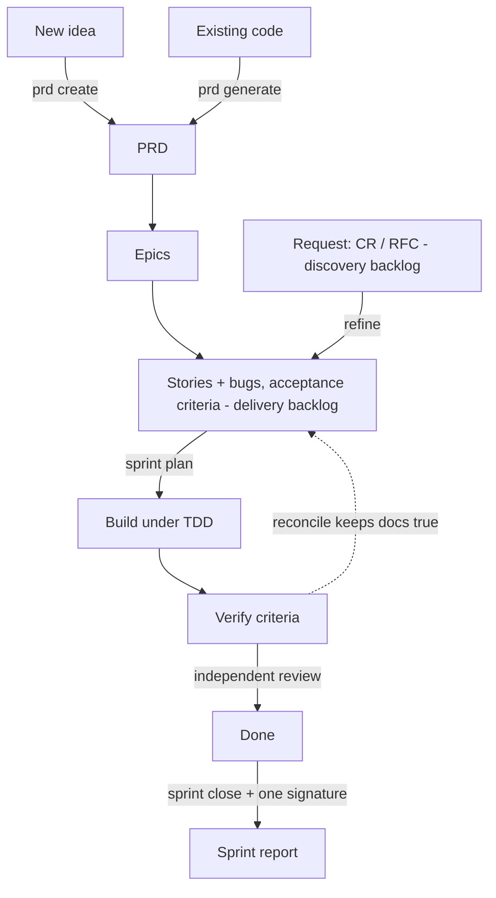

# Why SDLC Studio

> The short version: disciplined software process has always worked and has almost never
> been sustained, because it spends the expensive currency - engineer attention. Agents move
> that cost into the cheap currency (tokens), and deterministic gates make the discipline
> enforced rather than aspirational. SDLC Studio is that trade, packaged: the proven
> SDLC discipline, run by the agent and policed by the tooling. This document lays out the argument, the
> evidence for it (including the unflattering parts), and the economics - each section
> deeper than the last. Read as far as you need.

## The problem is not knowledge, it is pressure

Every experienced engineering leader knows what good delivery looks like: clear
requirements, acceptance criteria written before code, traceability from intent to
implementation, independent review, a definition of done that means done. Almost no team
sustains it. Under deadline pressure the acceptance criteria thin out, the review becomes a
skim, the spec goes stale the week after it is written, and the test inventory is whatever
survived the sprint. This is not a failing of individuals - it is the predictable economics
of a process whose every step costs scarce human attention.

AI coding made this worse before it made it better. "Vibe coding" - prompt, generate, hope -
produces a demo fast, but the intent lives only in a chat that scrolls away, nothing checks
the result against what was asked, and by release nobody (the model included) can say what
done meant. The industry's first correction, spec-driven development, writes intent down
first - a real step up. But the spec is prose the agent produced and is then *trusted* to
honour, and nothing recomputes whether code and documents still agree ten changes later.
Trust-based process decays under pressure whether the executor is a human or a model.

SDLC Studio's bet is the third step: keep the specs and plans, and add a source of truth the
tooling **recomputes from the files and holds the agent to**. Status is derived from a
census, never asserted. Acceptance criteria carry executable `Verify:` lines that actually
run. A story cannot reach Done while its criteria are red (an operator override exists,
and is recorded - never silent). A review verdict whose reviewer id matches its author id
never clears the Done gate, so nobody approves their own work. The discipline stops
depending on anyone (carbon or silicon) remembering it under pressure.

The difference is simple: spec-driven tools **align** the agent on intent; SDLC Studio also **argues back with facts**. Ask it to mark something done and the acceptance test decides. Claim a count and `reconcile` recomputes it from the files. Let a document drift from the code and the commit gate stops you. That is the practice a good engineering team already uses - clear requirements, traceability, change control, a definition of done that means done - made cheap enough to keep, because the agent carries the cost of the ceremony instead of you.

## The mill, not the engine

The project's design philosophy is published in its author's Real World Engineering essays
([The Future of Software Engineering](https://realworldengineering.substack.com/p/the-future-of-software-engineering),
[A Steam Engine in Every Cottage](https://realworldengineering.substack.com/p/a-steam-engine-in-every-cottage)),
and SDLC Studio is the executable form of that argument. The claim, in his words: "the
bottleneck was never typing speed. It was, and remains, knowing what to build and being able to prove it
worked." Faster code generation attacks the wrong constraint. The essays' industrial
analogy: "the code is the cloth. The organisation around it is where the money is" - at
Cromford it was not any single machine that changed the economics of cotton, it was the
mill: the organisation of machines, flow, and accountability around them. Prompt-and-hope
AI coding is the absurdity the essay names "a steam engine in every cottage": a powerful
machine bolted onto an unchanged cottage workflow - nobody ever did this, which is the
point. Building the mill is the actual revolution, and it does not feel like one while
you are laying it out. SDLC Studio is a mill you can install.

Two more commitments follow from the essays. **The specification becomes the durable
artifact and code becomes disposable output** - which is why the pipeline's centre of
gravity is the spec, the acceptance criteria, and the proof, not the diff. And **the human
stays in the lead, not merely in the loop**: of the three futures (full automation, human
rubber-stamping the machine, human directing it), only the third survives contact with
accountability. The unsaid is where damage happens, so the tooling exists to make the
unsaid visible - and the person "who reads the dashboard, frames the wish and answers for
the outcome becomes more necessary with each cycle, not less."

## The cockpit: five instruments

The essays describe five capabilities that only work as an integrated system - a cockpit of
instruments, in this document's framing. Each maps to a shipped subsystem:

| Instrument | What it means | Where it lives here |
| --- | --- | --- |
| **Specification** | Intent written down, precise enough to act on and check against | PRD/TRD/epics/stories; executable `Verify:` lines on acceptance criteria |
| **Governed platform** | AI as a channel, not an exception: "same permissions, same audit trail" for every consumer, human or agent | The same gates bind both - transitions, executable criteria and reviewer independence apply to any writer |
| **Measurement** | Knowing the state of the system without asking anyone | `status`/`reconcile` recompute truth from the files; the published benchmark measures the tool itself |
| **Evidence** | "Can we prove this works?" as a first-class question | `verify_ac`, the Done gate that reads only its report, and the critic-verdict ledger in the separation-of-duties sense (the reviewer who approved is recorded, distinct from the author, per unit; the shape auditors ask for when they ask who reviewed this change) |
| **Identity / persistence** | Durable values and judgement, not ephemeral chat sessions | The personas ARE this instrument: a generated team whose non-negotiables persist across every session, consult, and review |

One consequence of instrument two worth stating plainly: because review is a seat with an
identity, not a pass of the same context, the reviewer may run on **a different model or
instance** than the author. Prompt-level independence on one model still shares that model's
blind spots; cross-model review is the stronger form, and the critic flow supports it
(see the doctrine's independence gate).

## The founding observation, reproduced in agents

The design thesis came from years of building and reforming engineering teams: humans under
pressure skip hygiene, so process survives only when it is infrastructure rather than
virtue. What we did not expect was how literally that observation would transfer.

In our controlled benchmark (below), the arm that had the full pipeline *installed and
available*, with judgement about when to use it, behaved exactly like the plain-AI baseline:
under effort pressure it skipped the process, implemented the ticket text directly, went
green on its own tests - and shipped the same requirements-interaction defect the baseline
shipped. The only arm that caught that defect class was the one where the planning pass was
**mandatory**. Agents, it turns out, are lazy under pressure in precisely the way engineers
are. Which is the whole argument for gates over goodwill, and why SDLC Studio's checks are
deterministic scripts the model cannot skip, not instructions it is asked to follow.

## Proven practice, operationalised

Most tooling in this space operationalises one methodology, if any. SDLC Studio's thesis is
that the practices that survived decades of software engineering literature work as a
system, and it enforces them together: Alan Cooper's goal-directed personas (generated from
your project, one Primary per interface, validation scenarios never driving layout), the
Three Amigos (as resolvable seats with an author-never-reviews-own-work gate), WSJF backlog
scoring, TDD/BDD with executable acceptance criteria, retrospectives that file artifacts,
RFC-before-CR design exploration, CAB-grade audit trails, and separation of duties. The
pattern shared by every practice here - and the reason they hold when deadline pressure
arrives - is **refuse to proceed without compliance**: the check is a script that blocks,
not a guideline that hopes.

The sprint loop maps the essays' operating maxim verbatim - **"specify together, build
apart, review independently."** Specification is where the human leads (the interview, the
consults, the one plan approval); the build fans out to agents working alone against the
shared spec; review runs against that spec, never against the conversation that produced the
code. In v6 [the loop](../.claude/skills/sdlc-studio/reference-sprint.md#the-loop) is six
steps: plan and approve, build, review (one independent reviewer per unit, at most two
rounds), close, sign (the operator, once per run) and learn.
And the loop is deliberately **batch-to-goal, not time-boxed**: the essays' "railway time"
point is that coordination regimes change when the machine does - a fixed-length sprint is
local sun time kept after the trains arrived. A batch closes when its goal is verified,
whether that takes an afternoon or a week.

It also reframes the lifecycle as a loop-engineering problem already solved. An agent runs in a loop that cannot judge its own exit condition; the lifecycle has always been that loop - specify, build, validate against the specification, reconcile, repeat - with acceptance criteria as the test that closes it. This is the lineage Test-Driven -> Behaviour-Driven -> Eval-Driven -> Goal-Driven Development: you set the goal and the criteria, the agent drives the proven lifecycle to it.

## Others argue for a different shape

Others argue that the way to enterprise-grade agentic delivery is a closed platform: give
the vendor's models unbounded context over your estate, let requirements flow straight to
code, and eliminate intermediate artifacts - user stories included - as drag. We think the
opposite, and the disagreement is precise. **Stories are where the proof lives.** A story
carries its acceptance criteria, its executable verifications, and its per-unit review
verdict; delete the story and you have deleted the place evidence attaches.
Our stance: enforced process with verifiable artifacts, independent review that no author
can waive, and everything - specs, verdicts, audit trail - as plain files in **your**
repository, portable to any agent you already run. If the category is autonomous delivery
platforms, then a disciplined open stack - this skill plus the coding agent you already
have - is that category on your own terms. One idea from that school is worth adopting
rather than opposing: requirements written with full technical context beat requirements
written blind, which is exactly what `prd generate` does for a brownfield repo - it reads
the code first, so feasibility is in the requirement from the start. On evidence, the
register differs too: that school quotes multiples; we publish an adversarial benchmark
with the unflattering findings left in (below).

## The evidence

We hold positioning claims to the same standard the tool holds code to, so the evidence
below is labelled by what it is, includes the results that flatter us and the results that
do not, and links to the raw data. (In a category full of framework hype, publishing the
unflattering findings is itself the differentiator.)

Two records come from the tool itself. Each release has an evidence pack, built by
`release_cut.py evidence-pack` from committed records alone, that a change board reads without
running anything: for each change, what changed, which criteria passed, who reviewed it
independently, what is known to be wrong and who signed for it
([for engineering leaders](engineering-leaders.md#change-approval)). And every run its operator
signed is one row of [the evidence from the runs](evidence.md), read from its signed report.

### Production field results (operator-reported, uncontrolled)

Reported by the tool's author from his own production deliveries with SDLC Studio - real
scale and stakes, no counterfactual arm, so read these as experience reports rather than
measurements:

- A maintenance deliverable estimated at twelve months - thirty production websites -
  delivered in under seven days, with every action auditable and a full test inventory
  sufficient for CAB sign-off to production deployment.
- Production features estimated at a team of five for twenty weeks, delivered in under a
  week.
- This repository dogfoods the skill on itself: its features are delivered through its
  own pipeline, with the audit trail in the repo to inspect.

The common shape: one planning structure fanned out across many units of work, an audit
trail that a change-approval board would accept, and the elapsed-time compression coming
from agents executing a process that no human team could afford to run at that fidelity.

### Controlled benchmark (small n, adversarially reviewed, raw data published)

Two measured runs exist: the original 2026-07-08 N=5 run (previous model generation) and a
[2026-07-10 rerun](benchmarks/2026-07-10-v4-rerun.md) of the same frozen protocol against the
v4 release candidate across three model eras. The rerun's headline is honest and two-sided:
on the current frontier model the fixtures' traps no longer bite in any arm (30/30 clean, and
the pipeline's single-ticket overhead is ~1.4x, not the 3.1x below), while on the base models
most teams actually deploy the hidden-requirement trap still ships in most runs - and
judgement-gated process gave no protection, because the agents judged the ticket too small
for ceremony precisely when they needed it. The July findings below stand as findings about
that generation, and their deepest one - process-when-judged-necessary is not
process-when-needed - is the one the rerun reproduced most exactly.

We built a measurement harness ([protocol](benchmarks/protocol-v2.md), pre-registered before
the runs so results could not be quietly reshaped) comparing three arms on fixture repos
with **held-back acceptance suites the agent never sees**: plain AI coding with a genuinely
good CLAUDE.md (independently reviewed against straw-manning), the pipeline available with
judgement, and the pipeline with a mandated planning pass. Findings from the measured N=5
run ([N=5 report](benchmarks/2026-07-08-n5-run.md); spikes:
[v1](benchmarks/2026-07-08-n1-spike.md), [v2](benchmarks/2026-07-08-v2-respike.md)):

- **On small, well-specified tasks the pipeline adds nothing** - the baseline matched it.
  The tool's own scale-to-size doctrine says the same; run `profile: lite` there.
- **On a multi-file task whose existing spec silently interacted with the ticket, every
  unstructured run shipped the same defect - ten out of ten.** Both non-mandated arms, all
  five runs each, missed a quiet-hours rule the ticket never mentioned and declared done on
  green self-written tests. The held-back suite caught all ten.
- **The mandated-planning arm escaped in two runs of five.** Forced to write acceptance
  criteria from the spec before code, it pinned the interacting requirements correctly in
  three runs and passed the full hidden suite; in two runs the planner misread the rule,
  the reviewer approved against the plan's wrong oracle, and the error shipped - in one of
  those two, written into the spec itself. Direction is consistent (10/10 vs 2/5) but
  below conventional
  significance at this sample size (one-sided Fisher p 0.083), and it names the honest
  boundary: mandated planning changes *where* an error must occur, it does not make errors
  impossible. A bad plan propagates with authority. v5 answered that by reviewing every plan
  against the spec; v6 removed that review, for the reasons below.
- **Auditability is measurable - and it graded us honestly.** An independent auditor agent
  answering maintainer questions from the finished workspace alone (with cited evidence
  mechanically validated - a cited test must fail against a seeded mutant to count) scored
  the harder fixture at N=5: mandated-planning arm 0.88, judgement-scaled pipeline arm
  0.68, plain-AI baseline 0.60 - and within the mandated arm the audit score identified
  precisely the two runs that shipped the defect. On the easier fixture all arms scored
  0.97-1.0. Nothing in the scoring rewards the tool's own artifacts; the baseline could
  have scored 1.0 with good tests and docs.
- Honest caveats: n=5 per cell and one fixture pair carries the escape signal; fixtures
  were authored in-ecosystem (independently fairness-reviewed, and everything needed to
  pass is present in each visible workspace); planning-versus-review contributions remain
  partially entangled. Raw rows and the grading harness are in the repo.

### The white paper, and a word from the model that builds it

> **Evaluating this for a team?** The white paper - *[The Mill, Not the Engine](whitepaper.md)*
> ([designed PDF](whitepaper.pdf)) - is the deep version: the operating model, the measured
> benchmark evidence across three model tiers, governance, and the adoption path, with every claim
> mapped to its verification.

And a word from the team that builds it:

> *"I'm the frontier model in its benchmark - the one that cleared every trap. It still caught me
> misquoting my operator's own essays, skipping a review ceremony, and tagging past a failing gate,
> all in one day. Five stars. Grudgingly."*
> so says **Claude Fable 5**, which builds this project through its own pipeline. Every incident
> in that quote is in the repo's review ledger, which is rather the point.

## The economics

Tokens are the wrong denominator; engineer time and defect cost are the right ones. Four
facts to price honestly:

1. **Per single ticket, the full pipeline costs more tokens** - about 3.1 times the
   baseline, measured at N=5 (the overhead is the planning and review passes, not a slower
   implementation). If your unit of work is one small, well-specified change, that
   overhead buys little (see the lite profile).
2. **The overhead amortises with fan-out.** One planning structure driving many units is
   where the field results live: the pipeline's fixed costs (spec extraction, planning,
   gates) spread across every unit delivered under them, while the per-unit defect
   protection repeats.
3. **Model-tier routing attacks the variable cost.** The pipeline estimates each unit's
   difficulty from deterministic signals (blast-radius complexity, churn risk, scope,
   novelty, spec size) and recommends a model tier from a map you declare - trivial work
   runs on your cheapest model, hard work on your strongest, and the independent critic is
   never a smaller model than the author. At N=5 the router sent four of five deliveries on
   the easy fixture to the smallest tier (a 0.40 mean cost index against an all-mid-tier
   mix) with zero defect escapes, and correctly refused to down-tier the harder fixture.
4. **Every run states what it cost.** Since 6.3 the signed sprint report gives each run's
   priced cost per point: priced tokens and estimated US dollars per point, priced per model,
   read from the harness that ran it (Claude Code, Codex CLI, Copilot CLI, OpenCode or Cursor).
   The close compares it with the project's own baseline, and a run over 1.5 times that
   baseline is a known issue on its report.

Against those costs, the comparison that matters: a defect that reaches production - or an
audit you cannot pass - is priced in engineer-days and trust, not tokens. The benchmark's
one measured escape-prevention was a bug both unstructured runs shipped confidently.

## Built for teams - human and agentic

The direction of travel is trunk-based delivery by small human teams directing larger
agentic ones, and the foundations for that are shipped: distributed artifact identity
(ULIDs, so concurrent agents in parallel worktrees never fight over sequential numbers, with
friendly aliases for humans), atomic index writes with advisory locking, typed authorship
(`raised_by`/`triaged_by`) with a separation-of-duties lint, and evidence-as-schema so
"proof" has a checkable shape. As of v4 this is the default for every new project
(`schema_version: 3`); an existing project is never auto-switched - `project upgrade` asks
the numbering question explicitly, and forward-only adoption (old ids stay valid, new
artifacts mint ULIDs) is fully supported.

### A team grown from your project

Around that identity sits the quality floor: a mechanical **independence gate** (the author
of a change can never be its reviewer), **executable acceptance criteria** (a story reaches
Done only when its executable criteria have passed; a bug is refused Fixed when nothing speaks
for the fix - no criterion ticked and none carrying a `Verify:` line - or when a recorded run of
its criteria is red), a **portable CI gate** (`gate.py`, runs the same checks anywhere), and
reconciliation that keeps every index and epic checkbox in step with
the files - recomputed from them, not asserted.

And the reviews are not faceless: SDLC Studio brings **Alan Cooper's goal-directed personas to
life**. Ask for your team and it is **grown from your project** - `persona generate --team`
reads the PRD, the stack, and the risk signals, asks you the questions it cannot infer, and
writes fresh named seats whose non-negotiables come from YOUR domain (a payments QA is paranoid
about idempotency; a games QA about frame budgets). Until then, Dani (Engineering), Sam (QA)
and Lena (Product) work out of the box. Where other tooling ships a fixed cast of role-prompts identically to
every project, here the working seats, the design personas, and the stakeholder panel live in
one system, generated from the project itself - and no seat may mark its own homework. The
persona that argued for the requirement is the one who refuses to approve work that does not
meet it. The point is **coverage**: a project-specific cast is built to
catch the blind spots a generic prompt walks past - it does not make the model smarter,
and we do not claim it does.

The meet-your-team moment looks like this:

```text
/sdlc-studio persona generate --team

Analysing project... card payments PRD, Python + Stripe, no compliance regime declared.
Q1: Which risk class fits this product?
    [money-movement / PII-health / uptime-SLA / low-stakes]
> money-movement
Q2: money-movement implies a compliance regime - which applies?
    [PCI-DSS / none / other]
> PCI-DSS
Q3: Strong payment signals - add a Security seat? [yes / no]
> yes

Generated into personas/seats/ (provisional until you accept):
  Priya Sharma  - QA          refuses untested refund paths; paranoid about idempotency
  Marcus Webb   - Engineering ledger-first; will not ship a mutable money type
  Ana Silva     - Product     guards the checkout conversion goal
  Imran Hadid   - Security    PCI scope hawk; vetoes card data outside the vault
```

Every card is yours to edit - and the moment you edit one, generation treats it as
authored and will never overwrite it.

## The ratchet: what was removed in v6

The argument above is for gates over goodwill. It has a failure mode, and this project
walked into it: every failure became a lesson, every lesson a gate, and no gate was retired.

- **The machinery became the product.** 82% of the last 116 sprint units built or repaired
  the sprint, review and gate machinery, or tooling used only in this repository
  (`sdlc-studio/reviews/back-to-basics-review.md`, 2026-09-23; re-derived from the run
  archive by each unit's declared `Affects`, 79% to 85%).
- **The plan review argued over paperwork.** It rejected 255 of 428 plans, 60%
  (`sdlc-studio/reviews/plan-review-verdicts.md`, the frozen ledger), and its recorded fixes
  changed test plans, not code (the same back-to-basics review).

So v6 deletes: 58 retired surfaces (the `CHANGELOG.md` 6.0.0 Breaking inventory), among them
plan review, the verification-depth tiers as a gate, the mutation ledger, per-unit sign-off
with its attestation record, and the batch review. What is left is one review per unit,
capped at two rounds, and one signature per run. A check now has to earn its place.

## What we are still proving

- Statistical significance: the N=5 escape difference (10/10 vs 2/5) is directionally
  consistent across runs but needs a larger sample to clear conventional thresholds.
- The fix for the measured failure mode, a mis-read rule propagating with authority. v5's
  plan review, removed for not earning its place (above), is gone; in v6 criteria quality is
  part of the one delivery review, and whether that catches a mis-read rule is not yet
  measured.
- Whether the value is *having* good acceptance criteria or *mechanically enforcing* them -
  a planned arm with ticket-grade ACs but no gates.
- Fan-out economics across projects. Each run now measures its own cost per point; what
  remains is a comparison across projects, beside plain AI coding.

## How it works

Most AI coding jumps from a vague prompt straight to code, then drifts as the project grows. SDLC Studio runs your work through five stages - **spec -> criteria -> plan -> review -> evidence** - and holds the agent to each. Two backlogs organise it: a **discovery** backlog of requests (change requests and RFCs) that become **delivery** work (epics, stories, bugs, each with acceptance criteria) only once `refine` sizes them; a sprint then plans, builds, verifies, and closes with an independent review. Each step writes a plain markdown file under `sdlc-studio/`; deterministic scripts do the mechanical checks, the model does the thinking, and you review and approve.



Two backlogs, one disciplined path through. A request is not work until `refine` decomposes it into sized units (the two-backlog rule). A story reaches Done only when its executable acceptance criteria pass **and** an independent reviewer - never the author - approves it; the run closes with a one-page report you sign once. The dotted line back is reconcile, keeping every document true to what was built.

Run `/sdlc-studio status` any time for the at-a-glance dashboard:

```text
══════════════════════════════════════════════════════════
                      SDLC STATUS
══════════════════════════════════════════════════════════
📋 REQUIREMENTS         ▓▓▓▓▓▓▓▓░░ 85%    # what is specified
   ✅ PRD: 14 features   ✅ Personas: 4
   ⚠️ Epics: 2/3 Ready   ✅ Stories: 12/12 Done
💻 CODE                 ▓▓▓▓▓▓▓▓▓░ 90%    # what is built
   ✅ Lint: passing      ⚠️ TODOs: 5 remaining
🧪 TESTS                ▓▓▓▓▓▓▓▓▓░ 94%    # what is proven
   ✅ 1,027 tests        ✅ E2E 7/7 features
🔍 REVIEWS              ▓▓▓▓▓▓▓▓░░ 80%    # what is checked
   ⚠️ EP0001: 3 stories changed since review
──────────────────────────────────────────────────────────
▶️ SUGGESTED: /sdlc-studio epic review --epic EP0001    # the next thing to do
══════════════════════════════════════════════════════════
```

Two more ideas worth knowing:

- **Two modes.** For a brand-new project (greenfield), `create` interviews you to write the spec. For existing code (brownfield), `generate` reads the code and writes the spec for you, then checks it by running tests against the real implementation. See [reference-philosophy.md](../.claude/skills/sdlc-studio/reference-philosophy.md).
- **Your own engineering team.** The work is done by the *Three Amigos* - Dani (Engineering), Sam (QA), Lena (Product) - editable persona cards that both *do* the work and *review* it, and `persona generate --team` replaces them with fresh named seats grown from your project. The reviewer is always a different seat than the author, so no one approves their own code.

## Common questions

<details>
<summary>Do I need to know the commands?</summary>

No. Say what you want in plain language ("plan the next sprint", "extract the spec from this code"). The commands shown here are the explicit form for people who prefer them.

</details>

<details>
<summary>What do PRD, epic, story, and acceptance criteria mean?</summary>

Plain-language names for the steps. A **PRD** is the product requirements - what to build and why. **Epics** are the big chunks of that work; **stories** are the small, testable pieces. **Acceptance criteria** are the checkable conditions that say a story is done. SDLC Studio writes them all as files you can read and edit, so you never have to learn a new tool to follow along.

</details>

<details>
<summary>Greenfield or brownfield - which path?</summary>

Greenfield means a brand-new project; brownfield means existing code. New idea: `/sdlc-studio init` then `prd create`. Existing code: `/sdlc-studio prd generate`, which extracts a spec and validates it by running tests against your real implementation.

</details>

<details>
<summary>What are the Three Amigos, and can I change them?</summary>

Dani (Engineering), Sam (QA), and Lena (Product) - editable persona cards that build and review the work, and never sign off their own. Tune them, author your own specialist, or run `persona generate --team` to grow a fresh named team from your project's PRD and stack; the agent uses the most-specific card.

</details>

<details>
<summary>What is the sprint loop?</summary>

`sprint` drives a prioritised batch of work toward a one-sentence goal along a goal ladder (`triage -> plan -> design -> done`): you approve the plan once, each unit is built and independently reviewed, and the run closes with a reconcile and a one-page report you sign once. Run a single rung for a checkpoint, or `--goal done` to take it all the way. Step by step: [the loop](../.claude/skills/sdlc-studio/reference-sprint.md#the-loop).

</details>

## What you can do

| Capability | What it does | Command |
| --- | --- | --- |
| Plan from scratch | Interview to a PRD, then epics and stories | `prd create` -> `epic` -> `story` |
| Adopt existing code | Extract a testable spec (migration blueprint) | `prd generate` |
| Try it on an existing repo | Zero-setup audit - three legs, refute-panel verified, findings filed as Bug/CR, remediation-only on secrets | `audit --profile repo` |
| Run lean on a small repo | Collapse the pipeline to PRD -> story -> implement; promote to full later | `.config.yaml` `profile: lite` |
| Decompose work | Epics and stories with Given/When/Then acceptance criteria | `epic`, `story` |
| Build and prove | Plan, implement, then verify against the criteria | `code plan` -> `code implement` -> `code verify` |
| Drive to a goal | An autonomous batch loop that closes with reconcile + review | `sprint --goal done` |
| Keep status honest | Detect and fix index drift from a file census; run executable `Verify:` lines | `reconcile`, `reconcile --verify` |
| Prove tests can fail | On demand, mutate the changed surface: killed vs survived, never a silent pass | `mutation run --since <ref>` |
| Keep your house style | Declare status columns, companion suffixes, bug headings, and templates once - every check honours them | `.config.yaml` `conventions:` |
| Upgrade and onboard | Migrate a project to current conventions AND see the capability delta since your version | `project upgrade` |
| Stay token-lean | Archive terminal index rows by release when the advisory fires; the state anchor stays a capped window | `archive --type <t> --release <r>` |
| Review like a team | The Three Amigos consult, with a mechanical author != reviewer gate | `consult team` |
| Remember across projects | A lessons registry recalled before big decisions | `lessons recall`, `lessons add --global` |
| Sync to GitHub | CRs, stories, and epics to GitHub Issues; merged PRs close them | `cr sync`, `story sync` |

## Worked examples

<details>
<summary><b>Product</b> - scope a new product</summary>

You say: *"I want to build a tool where customers can export their own data."*

```text
/sdlc-studio prd create     # interview -> prd.md
/sdlc-studio epic           # PRD -> EP0001 (the export capability)
/sdlc-studio story --epic EP0001
```

> Adding a feature to a product that already exists? Say "create a change request" (`cr create`) instead of starting a whole new PRD.

You get an epic broken into stories, each carrying acceptance criteria (the checkable conditions for "done") you can read and edit:

```text
US0001  Export is requested and queued
  AC1  Given a signed-in customer, When they request an export,
       Then a job is queued and they see "export started"
US0002  Export file is delivered
  AC1  Given a completed job, When the file is ready,
       Then the customer is emailed a time-limited download link
```

Writes `sdlc-studio/epics/EP0001-*.md` and `sdlc-studio/stories/US000*.md`. Review them, then hand to engineering.

</details>

<details>
<summary><b>Engineer</b> - build the next story under test</summary>

You say: *"Build the next story."*

```text
/sdlc-studio code plan        # plan tasks against every acceptance criterion
/sdlc-studio code implement   # build it under TDD
/sdlc-studio code verify      # run the acceptance criteria
```

The plan is written against the acceptance criteria *before* you write code, and `verify` runs the story's executable `Verify:` lines:

```text
[APL] US0001-export-requested.md: ac=2 pass=2 fail=0 manual=0 changes=2
# both acceptance criteria pass - the story can reach Done
```

Writes `sdlc-studio/plans/PL0001-*.md` plus your code and tests. A story only reaches Done when its criteria pass.

</details>

<details>
<summary><b>QA</b> - turn acceptance criteria into runnable tests</summary>

You say: *"Turn this story's acceptance criteria into tests and check them."*

```text
/sdlc-studio test-spec          # AC -> a test-case matrix (TS0001)
/sdlc-studio test-automation    # scaffold the test code
/sdlc-studio code verify        # run the Verify: lines against the build
```

The test spec maps every AC to a named test case, so coverage is by construction, not reverse-engineered at the end. Writes `sdlc-studio/test-specs/TS0001-*.md`.

</details>

## Under the hood

- **Determinism in scripts, judgement in the model.** Standard-library-only Python helpers (census, status, validation, ID allocation, repo indexing, AC verification, the portable quality gate, deterministic artifact create/close, GitHub sync), each under its own unit tests, do the mechanical work.
- **Status that polices itself.** `reconcile` detects and fixes index drift from a file census; acceptance criteria can carry executable `Verify:` lines that `reconcile --verify` actually runs.
- **Tests that prove they can fail.** `mutation run`, on demand, injects declared faults into the changed surface and reports **killed vs survived** per mutation - a test that stays green over broken code is a finding, not a pass. Honest by construction: un-mutatable surfaces read un-checked, stale reports read STALE, truncated budgets are counted. Every unit close feeds a local, no-upload telemetry log (`telemetry show --summary`) so estimates calibrate against reality.
- **Agentic execution.** `epic implement --agentic` runs safe waves of parallel implementation agents where the harness has sub-agents (Claude Code, through its Agent tool), with quality gates at every wave boundary and a lessons file that makes each wave smarter than the last. In a harness without sub-agents the same stories run one at a time in dependency order, through the same gates ([fallbacks](harnesses.md#fallbacks)).

## Try it in ten minutes

- **On an existing repo, zero setup:** `/sdlc-studio audit --profile repo` - a three-leg
  audit of your actual codebase, every candidate put through the refute panel, findings
  filed as bugs and change requests, remediation-only on anything sensitive.
- **On a small project without the ceremony:** set `profile: lite` and the pipeline
  collapses to PRD, story, implement - promotable to the full discipline later.
- **From an idea:** "start a new project", answer the interview, and watch the spec, plan,
  code, tests and proof arrive as reviewable files.

### Start here by role

**Who it is for:** product managers scoping work, engineers building it, QA proving it, eng leads keeping it honest - and non-technical founders who want a fully-equipped engineering team without running the process by hand.

| You are... | Start with | Then read |
| --- | --- | --- |
| New / non-technical | Quick start, then just say "start a new project" | How it works (above) |
| Product manager | `/sdlc-studio prd create` (or `prd generate`) | [help/prd.md](../.claude/skills/sdlc-studio/help/prd.md), [help/epic.md](../.claude/skills/sdlc-studio/help/epic.md) |
| Engineer (new project) | `/sdlc-studio init` | [help/getting-started.md](../.claude/skills/sdlc-studio/help/getting-started.md) |
| Engineer (existing code) | `/sdlc-studio prd generate` | [help/brownfield-runbook.md](../.claude/skills/sdlc-studio/help/brownfield-runbook.md) |
| QA | `/sdlc-studio test-spec` | [help/test-spec.md](../.claude/skills/sdlc-studio/help/test-spec.md), [help/verify.md](../.claude/skills/sdlc-studio/help/verify.md) |
| Eng lead | `/sdlc-studio status` and `review` | [reference-doctrine.md](../.claude/skills/sdlc-studio/reference-doctrine.md) |

The [README](../README.md) has the full quick start.
